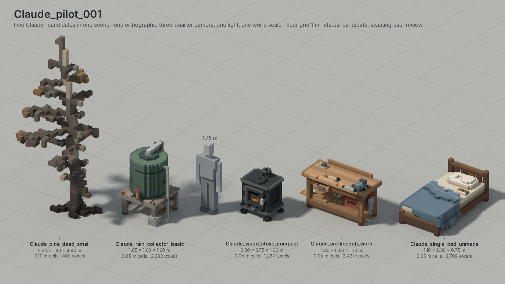
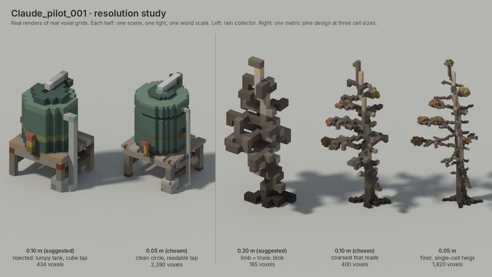

# Claude_pilot_001 — review sheet

**Status: all five models are `candidate`, awaiting the user's review.** Nothing here is approved, and nothing has been copied into Sirens Went Quiet or any other game.

- Creator: Claude, independent of GPT (no `GPT_` assets existed in the repository when this batch was made, so there is no side-by-side yet).
- Briefs: `docs/PILOT_BATCH.md`, commissioned by the user for the Claude batch on 2026-11-23.
- Specs: `docs/specs/<category>/Claude_<base_id>.md`.

## The five candidates

| Asset | Cell | Grid (cells) | Size W × D × H (m) | Voxels | GLB tris | Previews |
|---|---:|---|---|---:|---:|---|
| `Claude_workbench_worn` | 0.05 m | 36 × 18 × 22 | 1.80 × 0.90 × 1.10 (body 1.70 × 0.70, top at 0.90) | 2,427 | 1,100 | `previews/furniture/Claude_workbench_worn/` |
| `Claude_rain_collector_basic` | 0.05 m | 21 × 20 × 32 | 1.05 × 1.00 × 1.60 (stand 1.00 × 0.90) | 2,390 | 2,248 | `previews/survival/Claude_rain_collector_basic/` |
| `Claude_wood_stove_compact` | 0.05 m | 16 × 15 × 20 | 0.80 × 0.75 × 1.00 (plates 0.80 × 0.65) | 1,267 | 698 | `previews/survival/Claude_wood_stove_compact/` |
| `Claude_single_bed_unmade` | 0.05 m | 22 × 40 × 15 | 1.10 × 2.00 × 0.75 (frame 1.05 × 2.00) | 3,709 | 1,086 | `previews/furniture/Claude_single_bed_unmade/` |
| `Claude_pine_dead_small` | 0.10 m | 22 × 19 × 44 | 2.20 × 1.90 × 4.40 | 400 | 1,626 | `previews/vegetation/Claude_pine_dead_small/` |

Each preview folder holds `hero.png` (three-quarter view), `front.png`, `side.png` and `scale.png` (fixed 250 px/m, with the 1.75 m figure).

## Interpretation in one line each

- **Workbench:** a home-built garage bench. Forearm-polished front edge, painted vise with its T-handle slid over, hand saw on the end, drawer sagging on a broken runner, forgotten mug, red toolbox and offcuts on the shelf.
- **Rain collector:** a green water butt on a pallet-and-fence-post stand. One leg sits on a concrete block, a later post carries the galvanised inlet from the gutter, a red-lever tap overhangs the front, a grey overflow runs to the ground, and a ratchet strap holds the tank.
- **Wood stove:** a squat cast-iron box stove with overhanging plates and splayed feet, a smoked-glass door over a low ember bed, a coil-spring latch, an ash-pan slider, a pot-polished cooking lid, and a flanged 15 cm flue socket.
- **Single bed:** a dark-stained slatted bed, slept in. The duvet is thrown back and sliding off the side facing the camera, the pillow is lopsided with a head hollow, and a paperback lies face-down.
- **Dead pine:** a hand-placed whorl table, leaning away from the wind. The leader snapped and a crooked new top grew from a branch below it, the windward side is stripped, rust-brown tufts cling on the lee side, and the roots grip the ground.

## Resolution decisions (the main deviation from the suggested tiers)

The bible's rule is "the coarsest tier that preserves the silhouette and function". I applied it per model, with the brief's own requirements as the test.

| Asset | Suggested | Chosen | Why |
|---|---|---|---|
| Workbench | 0.10 | **0.05** | At 0.10 the top, shelf, apron and drawer become 10 cm slabs (a toy) and the required tools collapse into single cubes. |
| Rain collector | 0.10 | **0.05** | Built at 0.10 first and rejected: the lumpy 8-cell tank and the cube tap read as a placeholder. The pipes stay 10 cm thick. |
| Stove | 0.10 ("detail only if essential") | **0.05** | Every listed feature (hinges, latch, vents, feet, plate lips) is 2–5 cm. At 0.10 the stove is a generic furnace block. |
| Bed | 0.10 | **0.05** | The brief says "avoid toy-like thickness". At 0.10 the duvet is at least 10 cm thick and cannot fold or drape. |
| Dead pine | 0.20 | **0.10** | At 0.20 every limb is as thick as the trunk (a blob). 0.10 is the coarsest tier that keeps the pine branching. 0.05 also works (see below). |

Rendered side-by-side evidence exists for two of the five: the rain collector (a full 0.10 m build, rejected) and the pine (one design at three cell sizes), in `previews/batches/Claude_pilot_001_resolution_study.png`. For the other three the case rests on member thickness, not on a full 0.10 m build: the workbench had only an early plain 0.10 m block-out, and the stove and bed went straight to 0.05 m. If you want the other three tested at 0.10 m as well, ask and I'll build them for a fair comparison.

**Your call.** The pine is the only 0.10 m model, so its voxel rhythm is twice as coarse as the other four. Its generator is metric: `build(cell=0.05)` gives a finer, more delicate version (1,820 voxels) that matches the furniture. I kept 0.10 because the bible prefers the coarse tier for large silhouettes.

## How the previews were made

- All images are rendered by `tools/claude/voxrender.py` from the `.vox` files read back from disk (`tools/claude/preview.py`). There are no concept images or paint-overs.
- It is a ray tracer over the actual voxel cells: soft-shadowed sun (az 40°, el 50°), sky occlusion with a simple bounce term, seamless studio floor. Tone mapping is linear up to 0.8 with a soft shoulder, so a sunlit top face shows its exact palette colour.
- Cameras are orthographic. Hero: az −35°, el 30° (front and the −X side). Front: +Y elevation. Side: +X elevation. Scale: hero angle at a fixed 250 px/m with a 0.5 m floor grid.
- The contact sheet is one scene: one camera, one light and one world scale for all five plus the 1.75 m figure, with a 1 m floor grid.
- Light, camera elevation and background are identical across the batch.

## Validation

Run with `python3 tools/claude/validate.py`; every check below passed for all five models.

| Check | Tool | Result |
|---|---|---|
| VOX structure (header v150, `MAIN` > `SIZE`, `XYZI`, `RGBA`), bounds ≤ 256, no duplicate cells, valid palette indices | own strict parser | pass |
| Voxel count, grid size and metres match `model.json`; bounds tight to occupancy | own | pass |
| Ground contact (z = 0), pivot inside the footprint, one 6-connected piece (nothing floating, no corner-only joins) | own | pass |
| Independent VOX parse: identical voxel set and palette | **py-vox-io 0.1** | pass |
| Independent editor import: VOX → Goxel → `.txt` export, identical positions and colours | **Goxel 0.11.0** (headless, `xvfb-run`) | pass |
| GLB structure | **Khronos glTF-Validator 2.0.0-dev.3.10** | 0 errors, 0 warnings, 0 infos, 0 hints |
| GLB loads; bounds equal to the source mapped to Godot axes with the floor pivot; stands on y = 0 | **trimesh 5.2.2**, **pygltflib 1.16.5**, own | pass |
| GLB front: every +Y voxel face becomes a −Z face; CCW winding agrees with the normals; per-colour face area equals exposed voxel faces (no missing or extra faces) | own | pass |
| GLB renders with vertex colours, correct front and floor (one-off visual check, screenshot not committed) | **three.js r187** in headless Chromium | pass |
| Naming: `Claude_` prefix on ID, folder, `.vox`, `.glb`, spec and sheet; `creator: "Claude"`; status `candidate` in `model.json` and `catalog.json` | own | pass |
| Determinism: re-running the generators reproduces byte-identical `.vox` files | own | pass |

**Not verified (no GUI tools in the build environment):**
- Opening the files in **MagicaVoxel** itself. The format is the simple single-model v150 layout that MagicaVoxel reads, and Goxel's MagicaVoxel importer accepts it, but the GUI open is still pending.
- **Godot** import. The GLB follows the library mapping `(x, z, −y)` and is glTF-valid. How Godot applies `COLOR_0` vertex colours to the imported material has not been tested here.

## Honest limitations and compromises

- **Mixed voxel rhythm:** four models at 0.05 m and the pine at 0.10 m (see above).
- **All four "standard tier" briefs were moved to detail tier (0.05 m).** Counts stay small (1.3k–3.7k), but this is a deliberate deviation for you to accept or reject.
- **The pine is the least refined of the five.** At 0.10 m its limbs are chunky and gnarled; it reads well in silhouette (see `front.png`) but is blockier up close than the furniture.
- **Overall sizes include protrusions.** Footprints for placement are in `model.json` (`footprint_m`, `pivot_note`): vise and offcut on the bench, tap and overflow on the rain collector, latch handle on the stove, duvet drape on the bed.
- **Hollow shells:** the mattress, tank and firebox are closed hollow shells (no invisible fill). If a game converts them to destructible voxels, they will be hollow inside.
- **Stove window:** the glass is opaque by design. The embers are coloured voxels, not an emissive material; a glow would be a Godot-side material choice.
- **GLB:** greedy-meshed quads can create T-junctions, which some renderers show as hairline sparkles at grazing angles. There is no baked AO in the vertex colours (the bible asks the renderer to light the asset).
- **Pivot:** the pivot is not stored in the `.vox` (the format has none). It lives in `model.json` and is applied by the GLB exporter.
- **MagicaVoxel orientation:** the library front is +Y. MagicaVoxel's own default camera may show a different side first. That is a viewing difference, not a data problem.
- **Previews:** my own renderer's lighting is not Godot's, so in-engine colours will shift with the game's lighting and tone mapping.
