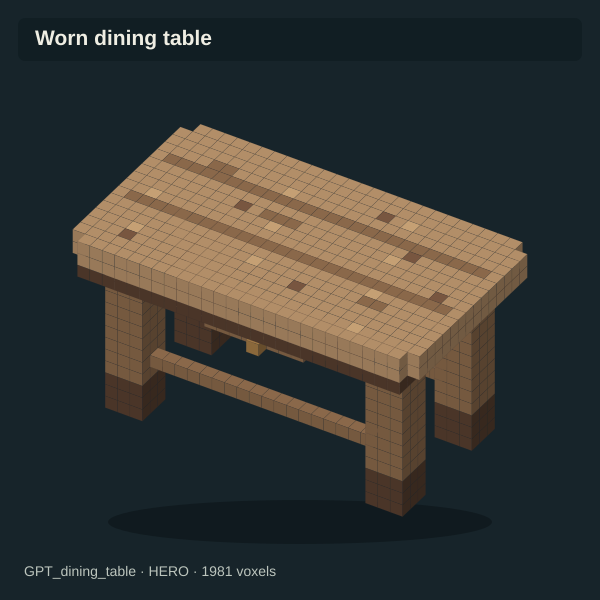
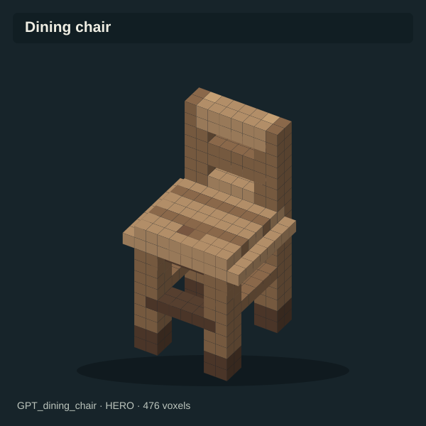
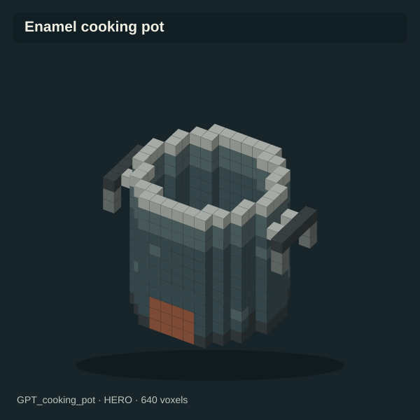
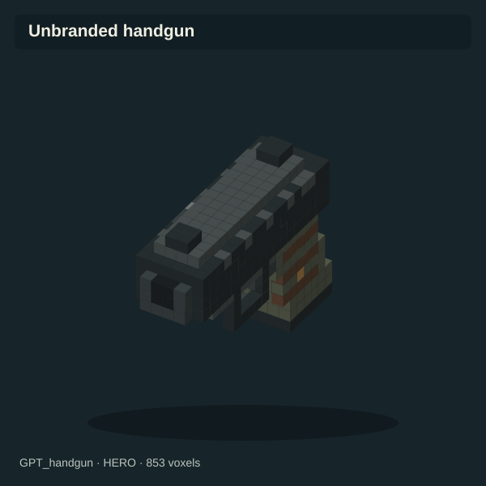

# GPT Round 002 — Four Household Candidates

**Status:** Four genuine binary `.vox` assets generated on branch `gpt/round-002`. All are `candidate`, not approved and not integrated into any game.

The models share the SirenVoxelLibrary muted contemporary palette, a 1 metre = 1 Godot unit convention, source +Y forward, source +Z up, and bottom-centre pivot. The table and chair are intentionally compatible in scale and material style.

| Candidate | Size (m) | Cell size | Occupied voxels |
|---|---:|---:|---:|
| `GPT_dining_table` | 1.40 × 0.80 × 0.75 | 0.05 m | 1,981 |
| `GPT_dining_chair` | 0.50 × 0.55 × 0.90 | 0.05 m | 476 |
| `GPT_cooking_pot` | 0.36 × 0.30 × 0.26 | 0.02 m | 640 |
| `GPT_handgun` | 0.06 × 0.23 × 0.17 | 0.01 m | 853 |

## Actual previews (directly generated from occupied VOX geometry)

### GPT dining table

[Editable VOX](../../models/furniture/GPT_dining_table/GPT_dining_table.vox) · [Front](../../previews/furniture/GPT_dining_table/front.svg) · [Side](../../previews/furniture/GPT_dining_table/side.svg) · [Metadata](../../models/furniture/GPT_dining_table/model.json)

### GPT dining chair

[Editable VOX](../../models/furniture/GPT_dining_chair/GPT_dining_chair.vox) · [Front](../../previews/furniture/GPT_dining_chair/front.svg) · [Side](../../previews/furniture/GPT_dining_chair/side.svg) · [Metadata](../../models/furniture/GPT_dining_chair/model.json)

### GPT cooking pot

[Editable VOX](../../models/survival/GPT_cooking_pot/GPT_cooking_pot.vox) · [Front](../../previews/survival/GPT_cooking_pot/front.svg) · [Side](../../previews/survival/GPT_cooking_pot/side.svg) · [Metadata](../../models/survival/GPT_cooking_pot/model.json)

### GPT handgun (static game-art prop)

[Editable VOX](../../models/survival/GPT_handgun/GPT_handgun.vox) · [Front](../../previews/survival/GPT_handgun/front.svg) · [Side](../../previews/survival/GPT_handgun/side.svg) · [Metadata](../../models/survival/GPT_handgun/model.json)

## Validation and exceptions

- Binary VOX 150 files use proper `MAIN`, `SIZE`, `XYZI`, and `RGBA` chunks and 256-cell-safe grid dimensions.
- Source shapes use unique occupied coordinates, a valid 1-based palette index and the occupied counts above.
- All preview SVGs are projected from the *same occupied voxels* as the sources; **they are not AI concept illustrations**.
- This first pass includes true SVG previews rather than the art bible's requested PNG files. They remain reviewable in GitHub and most browsers; PNG output is not yet done.
- Actual opening in the MagicaVoxel GUI, independent parser round-trip and Godot GLB export remain unverified; do not label those tests passed.
- There are no derived `.glb` files yet. The source `.vox` is the canonical editable model.

The proposed review criterion is appearance and recognizability in the voxel viewer. **Only the user can approve or reject any candidate.**
